# Airbnb Clone

An Airbnb-inspired full-stack stay marketplace built with Next.js, TypeScript, Tailwind CSS, FastAPI and SQLite.

**Live Demo:** <https://airbnb-clone-five-peach.vercel.app> (frontend on Vercel, API on Render). The API runs on Render's free
tier, so the first request after inactivity can take about a minute while it wakes up (see
[SQLite persistence on Render](#sqlite-persistence-on-render)).

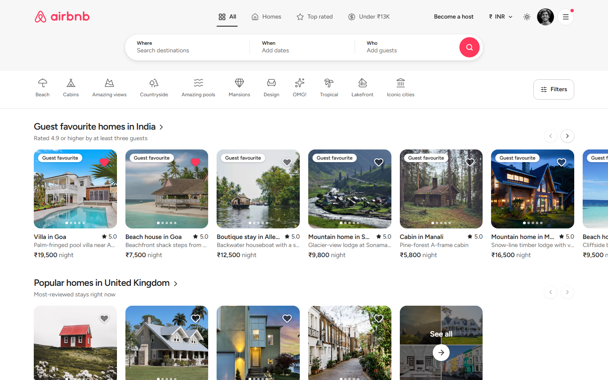

> **Independent educational project.** This is a learning/assignment project. It is **not affiliated with,
> endorsed by or connected to Airbnb, Inc.** "Airbnb" is a trademark of its owner; the name and pink pin
> mark are used here only to mimic the product for an educational exercise. The code was written for this
> assignment; a public Airbnb clone was consulted only for visual/UX ideas and no code, components or file
> structure were copied from it.

## Contents

[Features](#features) · [Screenshots](#screenshots) · [Tech stack](#tech-stack) · [Architecture](#architecture) ·
[Database](#database) · [Booking lifecycle](#booking-lifecycle-and-availability) · [Currencies, pricing & coupons](#currencies-pricing-and-coupons) ·
[API](#api) · [Demo accounts](#demo-accounts) · [Mock payment & printing](#mock-payment-and-booking-receipt) · [Local setup](#local-setup) ·
[Testing](#testing) · [Environment variables](#environment-variables) · [Deployment](#deployment) ·
[Demo guide](#end-to-end-demo-guide) · [Assumptions & limitations](#assumptions-and-known-limitations) · [Credits](#credits-and-licensing)

## Features

**Guest**
- **Curated Airbnb-style home page.** Horizontal carousels built from the real listings (*Guest favourite homes in India*, *Popular homes in …*, *Stays with amazing views*, *Homes with amazing pools*, *Cabins and cosy retreats*, *Design-led stays*, *Highly rated*, *More stays*). Every row ends with a **See all** card (photo collage + count) that opens the matching real, paginated search. Each listing appears in at most one row, rows with fewer than three stays are skipped, and the selection is deterministic. Arrows disable at the ends; phones swipe.
- **Fifteen display currencies** (default **INR**, switch in the header or the phone account sheet; saved in the browser). Indian listings are priced in rupees, UK ones in pounds, euro-zone ones in euros and so on; the **server** converts every price, quote, filter and booking with one illustrative rate table. See [Currencies, pricing and coupons](#currencies-pricing-and-coupons).
- **Adaptive header.** A fixed bar of constant height with the `airbnb` wordmark, **quick-filter tabs** (*All · Homes · Top rated · Under ₹13K*), *Become a host*, the currency selector, a light/dark switch and the account menu. On the home page a large *Where / When / Who* pill sits under it and collapses smoothly as you scroll (driven by `scrollY`: no layout jump and no blank band) into a compact capsule. On **every** route the capsule opens the same full search in a drop-down panel; phones use a search sheet.
- **Working quick filters.** *Homes* (whole-home property types), *Top rated* (4.8+) and the *budget* tab (about US$150 a night, shown in the display currency) all change the real results, are stored in the URL (`?quick=`), and combine with the destination, dates, category rail and advanced filters.
- **Real search results** driven by the URL: destination, dates, guests, category rail, a Filters modal (price range in the display currency, property type, rooms/guests, rating, amenities) with a **live result count from the server**, sorting (price sort is currency-aware), **server-side pagination**, skeletons and empty states with reset actions.
- **Listing page:** asymmetric gallery and full-screen viewer (arrow keys / Esc), guest-favourite callout, map section with a link to the full map, reviews, sticky booking card (bottom sheet on phones) with unavailable nights struck through and a **server-calculated price quote**.
- **Checkout and booking receipt:** coupon, mocked payment (decline + retry), a confirmation page, and a dedicated **print-only receipt** (*Print booking / Save as PDF*) that contains only the booking document. See [Mock payment and booking receipt](#mock-payment-and-booking-receipt).
- *Trips* (upcoming / past / cancelled, cancel with refund), wishlist, reviews for completed stays, and a guest ↔ host inbox ([Messaging](#messaging)).
- **Light by default, dark on request:** first-time visitors always get the light theme (whatever their OS prefers); the switch beside the avatar saves the choice and it is applied before first paint (no flash). Every colour is a design token.

**Host**
- Dashboard with statistics (earnings converted to the display currency), listings and reservations received; create / edit / pause / delete listings (ownership enforced; deletion is refused while upcoming reservations exist). A listing's price currency follows its country and the form says so.

**Backend**
- Half-open date-range overlap logic, transactional booking creation (`BEGIN IMMEDIATE`), server-side pricing and currency conversion, coupon validation across currencies, host ownership checks, consistent JSON errors, signed demo identities, an idempotent column migration for older SQLite files. A 48-listing seed catalogue (India, Europe, Asia, US/UK/UAE).

## Screenshots

Captured from the running production build with the seeded demo data (see [Testing](#testing)). Prices are in the default currency, INR.

| | |
| --- | --- |
| 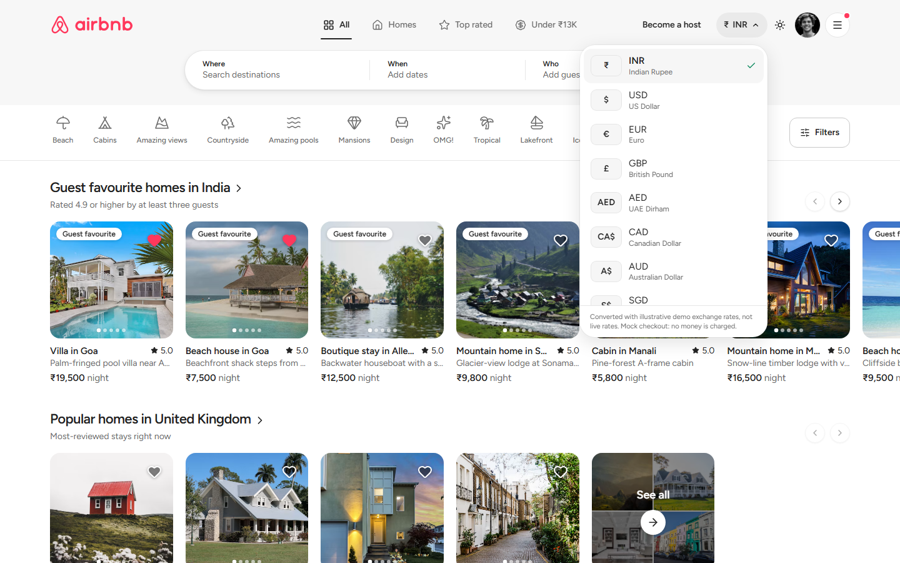 <br> Currency selector (15 currencies, saved in the browser) | 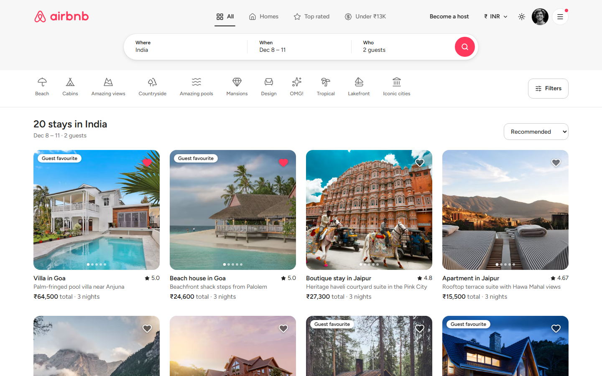 <br> Search results: destination, dates, guests, category rail |
| 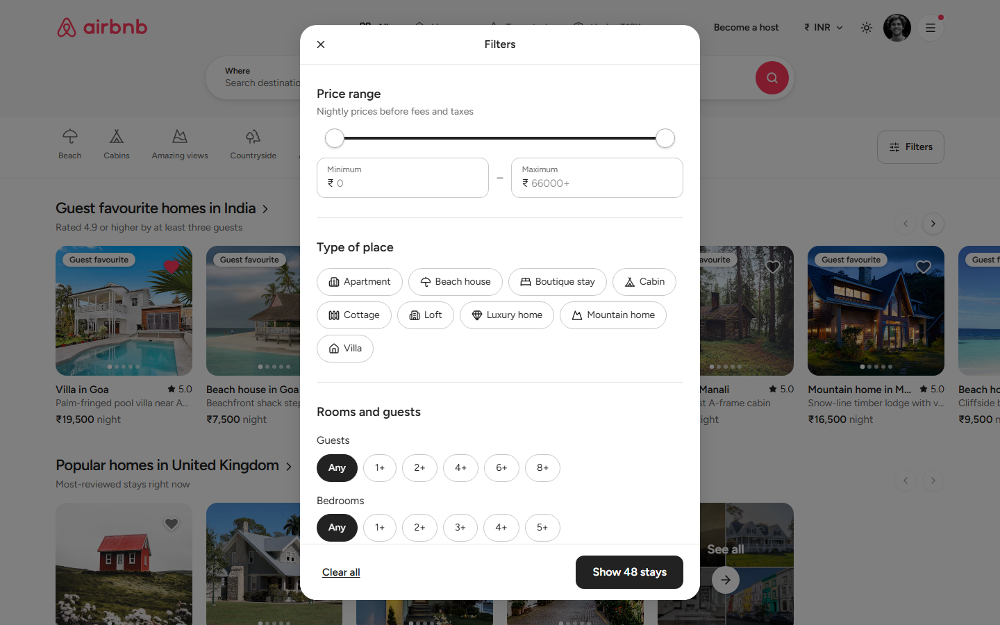 <br> Filters with a live server result count | 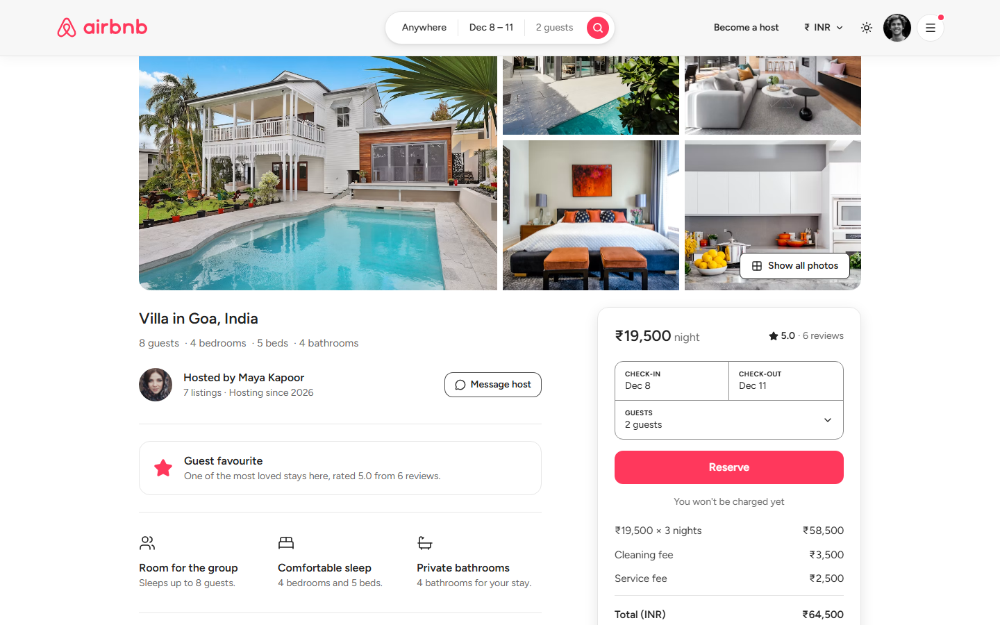 <br> Listing detail with server-priced booking card |
| 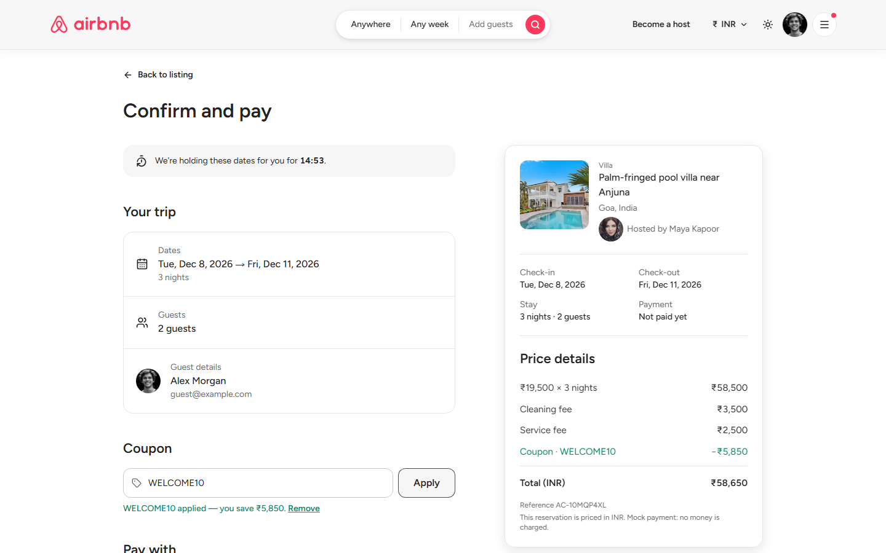 <br> Checkout: server-validated coupon + mock payment | 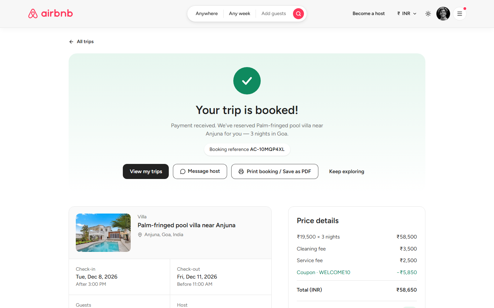 <br> Confirmation with print / message-host actions |
| 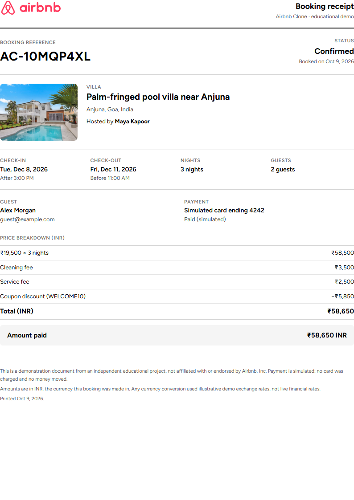 <br> The print-only receipt (A4, what *Save as PDF* produces) | 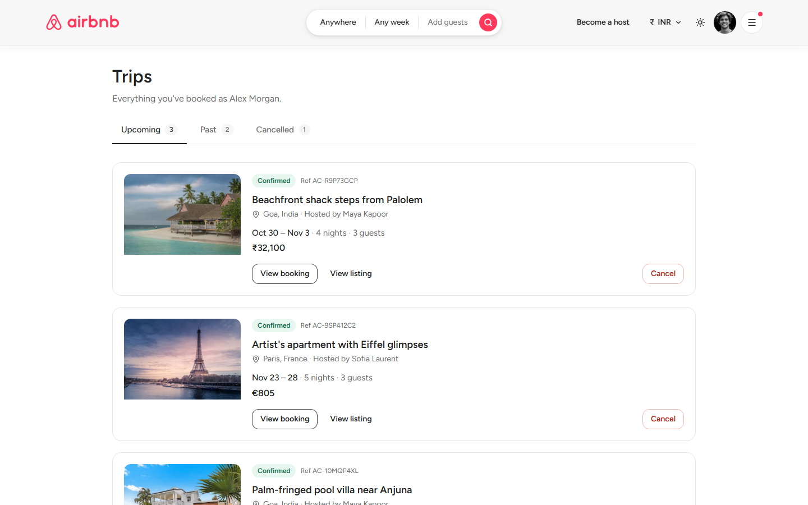 <br> My Trips |
| 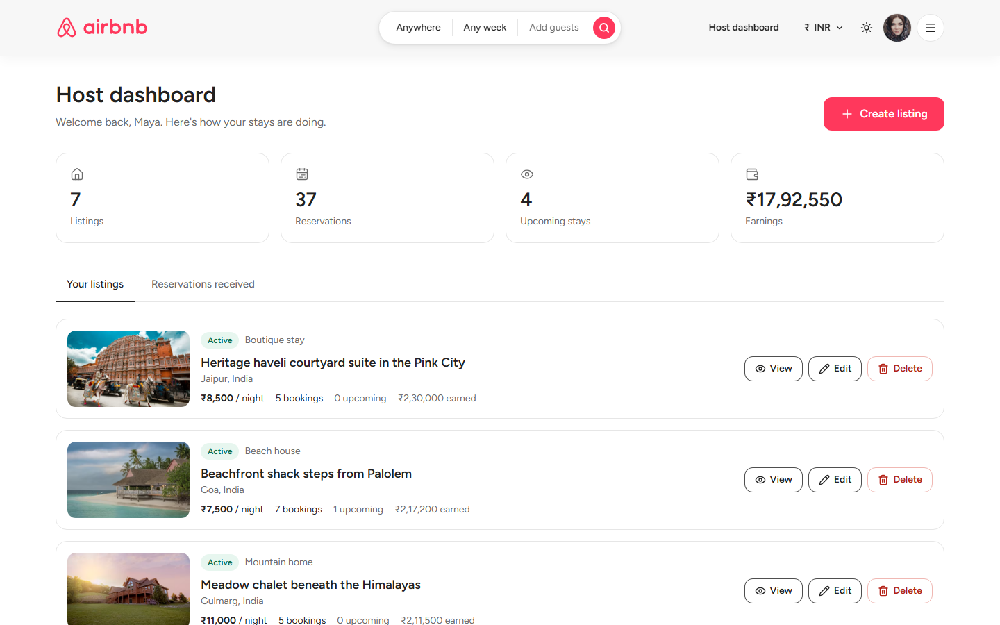 <br> Host dashboard | 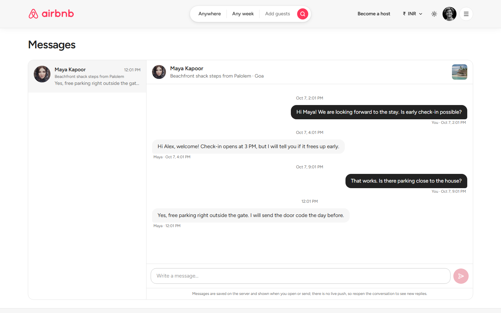 <br> Messages |
| 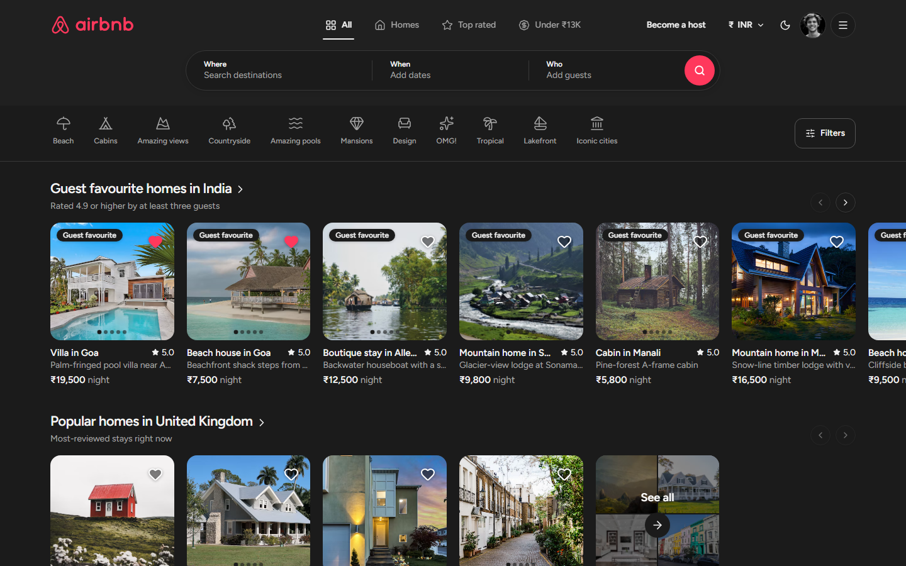 <br> Dark mode | 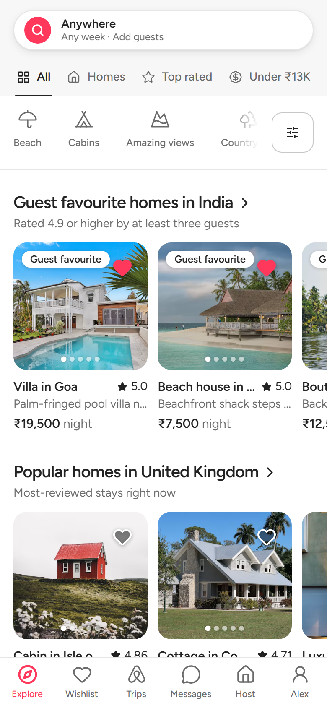 <br> Phone layout with the symbol-mark *Trips* tab |

## Tech stack

| Layer | Choice |
| --- | --- |
| Frontend | Next.js 16 (App Router), React 19, TypeScript, Tailwind CSS v4, lucide icons |
| Backend | Python 3.11+ (developed on 3.13), FastAPI, SQLAlchemy 2, Pydantic v2 |
| Database | SQLite (WAL mode, foreign keys on) |
| Tests / checks | pytest + FastAPI `TestClient`; `node --test` (currency helpers); `tsc`, ESLint and `next build` |

## Architecture

```
airbnb-clone/
├── frontend/                Next.js app
│   └── src/
│       ├── app/             routes: /, /listings/[id], /checkout/[id], /trips, /trips/[id],
│       │                    /wishlist, /messages, /host, /host/listings/new, /host/listings/[id]/edit
│       ├── components/      layout/ (header, wordmark, quick-filter tabs, currency + theme controls, account menu,
│       │                    mobile tab bar), search/, filters/, listing/ (cards, carousels, See-all card, gallery, booking
│       │                    panel), booking/ (checkout, trip page, BookingReceipt), host/, messages/, calendar/, ui/
│       ├── context/         AppProvider: current demo user, wishlist ids, unread-message count
│       ├── hooks/           useFetch (abort + stale-while-revalidate), useDebounced, ...
│       └── lib/             typed API client (lib/api), URL <-> filters mapping, quick-filters, discovery sections
│                            (home-page rows), currency (+ store and node tests), theme, dates
├── backend/
│   ├── app/
│   │   ├── main.py          app factory, CORS, error handlers, optional auto-seed
│   │   ├── core/            settings (env), errors, signed demo-session tokens, currency.py (rates, conversion, formatting)
│   │   ├── db/              engine, SQLite pragmas, BEGIN IMMEDIATE write sessions, migrations.py (ADD COLUMN upgrades)
│   │   ├── models/          SQLAlchemy models        ├── schemas/   Pydantic models
│   │   ├── services/        business rules: pricing, coupons, availability, bookings, listings, messaging
│   │   ├── routers/         thin HTTP layer          └── seed.py, seed_data.py, seed_extra.py
│   ├── tests/               106 tests
│   ├── seed.py              CLI seeding (python seed.py [--reset])
│   └── requirements.txt
├── docs/screenshots/        images used in this README
├── render.yaml              Render blueprint for the API
└── README.md
```

**Data flow.** The URL is the source of truth for a search (`/?location=Goa&check_in=…&guests=2&property_type=Villa&quick=top-rated&page=2`).
With no search criteria the home page shows the curated rows (one `GET /api/listings?page_size=48`; `lib/discovery.ts` derives the rows
client-side, and each row's **See all** link is the same rule expressed as a normal search query, so it always lands on real, paginated
backend results). Any criteria, or `?view=all`, switch to the results page that calls `GET /api/listings`. `?quick=` is translated into
ordinary backend filters (`min_rating`, `max_price`, `property_type`) by `lib/quick-filters.ts` and never replaces the user's own filters.
The listing page fetches the listing, its availability and a debounced **server quote** whenever dates, guests or coupon change; the
browser never does price arithmetic. Price-bearing GET requests automatically carry `currency=<display currency>`
(`lib/api/client.ts`), every data fetch re-runs when the currency changes, and the URL, dates, guests, filters and wishlist are untouched.
Price bounds in the URL remember the currency they were typed in (`?max_price=12000&cur=INR`), so switching currency converts them
instead of misreading ₹12,000 as $12,000.

**Design system.** Colours, radii and shadows are CSS tokens in `globals.css` (`@theme`); the dark theme redefines the same tokens under
`html[data-theme="dark"]`, so components never hard-code light-only colours. The browser tab title is the fixed string `Airbnb Clone` on every route.

## Database

Tables: `users`, `listings`, `listing_images`, `amenities`, `listing_amenities`, `bookings`, `payments`, `coupons`,
`coupon_usages`, `reviews`, `favorites`, `conversations`, `messages` — foreign keys on, unique constraints, cascades.

```
users 1──* listings 1──* listing_images          listings *──* amenities (listing_amenities)
users 1──* bookings *──1 listings                bookings 1──1 payments      bookings 1──1 reviews
bookings *──0..1 coupons (coupon_usages)         users *──* listings (favorites)
conversations: (listing, guest) unique, host = listing host   conversations 1──* messages (sender -> users)
```

* `bookings.listing_id` is `RESTRICT`: a listing with booking history is **soft-deleted** (`status = DELETED`) so guests keep their trips; its favourites are removed.
* `payments.booking_id`, `reviews.booking_id` are unique (one payment / review per booking); `favorites` has a composite key.
* Indexes on listing city/location/type/price, booking `(listing_id, check_in, check_out)` and `(guest_id, status)`, review and message lookups.
* Currency columns: `listings.currency` (the currency of its three price columns, derived from `country`) and `bookings.currency` (the booking's snapshot currency). Both are `VARCHAR(3) NOT NULL DEFAULT 'USD'`.
* Tables are created on startup (`create_all`). Columns added later are applied by `app/db/migrations.py` with idempotent `ALTER TABLE … ADD COLUMN`, so an existing SQLite file keeps its data (older rows keep `USD`, the unit their amounts were stored in). There is no general migration framework. A demo database seeded before currency support keeps its dollar prices; run `python seed.py --reset` to rebuild it with the local-currency catalogue (this drops the demo data, as documented in [Local setup](#local-setup)).

## Booking lifecycle and availability

* **Half-open ranges.** A booking occupies nights `[check_in, check_out)`. 10→15 and 13→17 overlap (rejected); 10→15 and 15→18 do not (accepted — same-day turnover). One predicate (`existing.check_in < new.check_out AND existing.check_out > new.check_in`) is shared by search, availability, quotes and booking creation.
* **Atomic check-then-insert.** Booking creation runs in a `BEGIN IMMEDIATE` transaction, so the availability check and the insert can't interleave with another writer. A threaded test fires 6 simultaneous requests for the same dates: exactly one `201`, five `409`.
* **State machine.** Booking `PENDING → CONFIRMED → COMPLETED`, or `→ CANCELLED`; payment `PENDING → SUCCESS | FAILED`, `SUCCESS → REFUNDED`. A `PENDING` booking holds its dates for 15 minutes (`hold_expires_at`); expired holds are released lazily on the next read/write. `CONFIRMED` stays whose check-out has passed become `COMPLETED` (unlocking reviews).
* **Cancellation** is free until the check-in day: it releases the dates, refunds the payment and returns the coupon use.

## Currencies, pricing and coupons

**Native prices.** Every listing is priced by its host in the currency of its (structured) `country`, and `GET /api/currencies` lists
what the app supports. Amounts are **whole units** of a currency (integers: no cents, no floating point). Indian listings are in rupees
(roughly ₹3,800–₹19,500 a night, scaled to size and category), UK in GBP, France/Spain/Italy/Greece/Portugal in EUR, UAE in AED, Japan in
JPY, Indonesia in IDR, Switzerland in CHF, the US and the Maldives (not in the supported list) in USD. Hosts see which currency the
price fields use and cannot pick it directly; it is re-derived whenever the country changes, and price sanity bounds are checked in USD
terms so they mean the same in rupees or yen.

**Supported currencies and demo rates** (units per US$1; canonical base **USD**). These are **illustrative demonstration rates, not live
financial rates**, and no exchange-rate API is called. The mock checkout never charges money.

| | | | |
| --- | --- | --- | --- |
| INR ₹ — 84 | USD $ — 1 | EUR € — 0.92 | GBP £ — 0.79 |
| AED — 3.6725 | CAD CA$ — 1.36 | AUD A$ — 1.52 | SGD S$ — 1.34 |
| JPY ¥ — 150 | THB ฿ — 35 | IDR Rp — 15,800 | CHF — 0.88 |
| NZD NZ$ — 1.65 | KRW ₩ — 1,350 | MYR RM — 4.5 | |

**Conversion and rounding.** One function (`core/currency.py::convert`) computes `amount × rate[to] ÷ rate[from]` with `Decimal` and
rounds half-up to a whole unit; the frontend never converts prices (it only formats them, `lib/currency.ts`, with the same symbols and
Indian lakh grouping as the server, tested with shared vectors). Zero-decimal currencies (JPY, KRW) have no fractions by definition and
all others are shown in whole units too.

**Server-authoritative pricing.** For a stay the server converts the nightly rate, the cleaning fee and the service fee individually,
then `subtotal = nightly × nights` and `total = subtotal + cleaning + service − discount`, so a breakdown always adds up exactly. The
browser's `total`, `subtotal`, `discount`, `rate` and similar fields are ignored (tested). Money is never computed in the UI.

**Display currency, filters and sorting.** Search and meta endpoints take `currency=` (default INR). `min_price` / `max_price` are in that
currency and the price sort orders by the *converted* price across listings with different native currencies (one SQL expression with the
same rounding), so a price shown in rupees is never filtered or sorted as dollars. Cards, the detail page, quotes, carousels' *See all*
searches, Trips, the host dashboard and receipts all use the same server values.

**Booking currency snapshot.** `POST /api/bookings` accepts `currency` (default: the listing's own). The booking and its payment are
priced and stored in that currency and keep it forever: changing the display currency or the demo rates later never rewrites a booking
(tested with a changed rate). The quote, the checkout total, the confirmation, Trips, the host's reservation list and the printed receipt
show identical amounts. Host earnings are converted to the requested display currency at read time with the demo rates.

**Coupons across currencies.** Coupon money (minimum subtotal, discount cap, flat value) is defined in **US dollars**. For a stay priced
in another currency those figures are converted with the same rates and then compared and capped in the stay's currency, so
"US$500 off" is never read as "500 rupees":

| Code | Rule (USD) | In INR | In JPY |
| --- | --- | --- | --- |
| `WELCOME10` | 10 % off stays over US$100, cap US$150 | min ₹8,400 · cap ₹12,600 | min ¥15,000 · cap ¥22,500 |
| `SUMMER20` | 20 % off stays over US$600, cap US$300 | min ₹50,400 · cap ₹25,200 | min ¥90,000 · cap ¥45,000 |
| `FLAT50` | US$50 off stays over US$300 | ₹4,200 off over ₹25,200 | ¥7,500 off over ¥45,000 |
| `FLAT500` | US$500 off stays over US$2,500 | ₹42,000 off over ₹2,10,000 | ¥75,000 off over ¥375,000 |
| `EXPIRED2020` · `PAUSED15` · `FIRSTSTAY` | demonstrate the *expired*, *inactive* and *usage limit reached* errors | | |

Coupons are validated server-side (unknown, inactive, expired, below minimum, usage limit, capped discount); each applied coupon creates
a `CouponUsage` row, and the discount can never exceed the stay subtotal.

## API

Interactive docs: `http://localhost:8000/docs`. Errors are `{"detail": "<message>", "code": "<machine_code>"}` (422 adds `errors: [{field, message}]`).

| Method & path | Purpose |
| --- | --- |
| `GET /api/currencies` | Supported currencies, demo rates (units per US$1), country → currency map |
| `GET /api/listings` | Search: `location, check_in, check_out, guests, min_price, max_price, property_type (csv), category, amenities (csv, all), min_rating, bedrooms, bathrooms, sort, currency (default INR), page, page_size (≤48)` — paginated; prices, price filters and the price sort are in `currency`; unavailable and over-capacity listings are excluded |
| `GET /api/listings/{id}` | Listing detail; `?currency=` converts the prices, omitted = the listing's native currency (what a host edits) |
| `POST /api/listings` · `PUT /api/listings/{id}` · `DELETE /api/listings/{id}` | Host CRUD (ownership enforced; delete refused while upcoming reservations exist) |
| `GET /api/listings/{id}/availability` · `GET /api/listings/{id}/quote` | Blocked nights · authoritative price + bookability (`?currency=` prices the stay in that currency) |
| `GET /api/meta` · `GET /api/destinations` | Filter vocabulary and price bounds (`?currency=`) · destination autocomplete |
| `POST /api/bookings` | Create a `PENDING` booking (holds dates 15 min); body may include `currency` (the booking's snapshot currency) |
| `GET /api/bookings` · `GET /api/bookings/{id}` | My trips · one booking |
| `PUT /api/bookings/{id}/coupon` | Apply/remove a coupon while pending |
| `POST /api/bookings/{id}/pay` | Mock payment |
| `POST /api/bookings/{id}/cancel` | Cancel + refund + release dates |
| `POST /api/coupons/validate` | Check a code against a listing + dates (or a subtotal) in `currency` |
| `GET /api/favorites` · `GET /api/favorites/ids` · `POST`/`DELETE /api/favorites/{listing_id}` | Wishlist (idempotent) |
| `GET /api/listings/{id}/reviews` · `POST /api/listings/{id}/reviews` | Reviews (posting needs a completed stay) |
| `GET /api/host/listings` · `/host/bookings` · `/host/summary` | Host dashboard data (`?currency=` for prices and earnings) |
| `GET /api/conversations` · `GET /api/conversations/unread-count` | My conversations · unread total |
| `POST /api/conversations` | Message a listing's host (re-uses the thread for that listing) |
| `GET /api/conversations/{id}` · `POST /api/conversations/{id}/messages` | Open a thread (marks incoming read) · send a message |
| `GET /api/users/current` · `GET /api/users/demo` · `POST /api/users/switch-demo-role` | Demo identity |
| `GET /api/health` | Liveness (used by Render) |

## Demo accounts

There is no sign-in. You start as the **demo guest** (Alex Morgan). Open the **menu button (top-right, or *Alex* on the phone
tab bar)** and pick another account under *Demo accounts*; the switch is instant.

| Account | Role | Notes |
| --- | --- | --- |
| `guest@example.com` — Alex Morgan | Guest | Upcoming trips, a cancelled trip, wishlist, a reviewed stay, one stay waiting for a review, one unread message |
| `host@example.com` — Maya Kapoor | Host | Owns 7 listings (Goa, Jaipur, Srinagar/Gulmarg, Varkala), bookings and reviews |
| `arjun.host@…`, `sofia.host@…`, `kenji.host@…`, `oliver.host@…`, `nia.host@…` (`@example.com`) | Host | Other hosts (Arjun owns the Kerala / Kashmir / Himachal listings) — use them to verify ownership checks |
| `priya@`, `liam@`, `emma@`, `noah@`, `ava@`, `lucas@`, `zoe@` (`example.com`) | Guest | Own the seeded bookings and reviews |

**How identity works.** `POST /api/users/switch-demo-role` returns an HMAC-signed bearer token naming a user. Every request
verifies the signature and **loads the role from the database**, so a client cannot forge an identity, role or owner. No token →
the default demo guest. Host endpoints require a host; edit/delete verify `listing.host_id == current user` (403 otherwise);
bookings can be paid/cancelled only by their guest; conversations only by their two participants.

## Mock payment and booking receipt

No gateway and no card data. At checkout choose **card ending 4242** → payment succeeds and the booking is `CONFIRMED`;
choose **card ending 0002** → `402 Payment declined`, the booking stays `PENDING` and the dates stay held so you can retry
with 4242 (internally `card_4242` / `card_declined`). Repeating a payment on a confirmed booking is a harmless no-op, the pay button is
disabled while a payment is in flight, and the checkout says in several places that nothing is really charged.

**Checkout** shows the property photo, title, location and host, check-in/out, nights and guests, a labelled price breakdown in the
booking's currency (nightly × nights, cleaning, service, coupon, total), the payment status, a countdown for the 15-minute date hold,
and clear cancel/back actions. A reservation keeps the currency it was made in even if you later browse in another one (the page says so).

**Print booking / Save as PDF.** The confirmation page and every booking page contain a dedicated `BookingReceipt` that is visible only
in print (`@media print`, `@page` A4 with margins). All app chrome (header, tabs, search, footer, mobile bar, toasts, buttons) is
`print:hidden`, so the printout is just the document: brand mark, reference and status, the property (photo, title, address, host),
check-in/out, nights, guests, guest, the simulated payment method and status, the itemised breakdown with the total and "amount paid /
due / refunded" in the booking currency, creation date and a footer explaining that payment is simulated and rates are illustrative.
Colours are fixed (dark text on white) so it prints correctly even in dark mode. It uses the browser's built-in print / save-as-PDF
(no PDF library); the headers and footers Chrome itself adds (URL, date) are the browser's setting and cannot be removed by a web page.

## Messaging

A lightweight guest ↔ host inbox, persisted in SQLite — no WebSockets or push (the list refreshes on navigation and after you send).

* **Inbox:** *Messages* in the account menu (with an unread count and a dot on the menu button) → conversation list + thread; one pane at a time on phones.
* **Start a chat:** *Message host* on any listing page (not shown on your own listings).
* **Seeded demo thread:** Alex ↔ Maya about the Goa beach house; Alex has one unread reply, so the unread indicator is visible immediately.
* **Security:** the sender is always the signed-in user (any `sender_id` in the request body is ignored); only the two participants can read or post (403 otherwise); bodies are trimmed and limited to 1–2000 characters.
* Opening a thread marks the other person's messages as read; the writes use `BEGIN IMMEDIATE` like bookings (a threaded test opens one thread from 6 clients at once).

## Local setup

Prerequisites: Python 3.11+, Node 20.9+ and npm.

**Backend** (http://localhost:8000)

```bash
cd backend
python -m venv .venv
.venv\Scripts\activate            # macOS/Linux: source .venv/bin/activate
pip install -r requirements.txt
cp .env.example .env              # optional; defaults work locally (Windows: copy .env.example .env)
python seed.py                    # optional: creates + seeds airbnb_clone.db (no-op if already seeded)
uvicorn app.main:app --reload --port 8000
```

The server also creates the tables and seeds an *empty* database on startup (`AUTO_SEED=true`), so `uvicorn` alone is enough.
`python seed.py` never deletes data unless you pass `--reset` (drops and rebuilds every table; use it to adopt the local-currency catalogue on an old demo database). Seeded bookings use dates
relative to the day of seeding.

**Frontend** (http://localhost:3000)

```bash
cd frontend
npm install
cp .env.example .env.local        # NEXT_PUBLIC_API_URL=http://localhost:8000
npm run dev
```

Production build: `npm run build && npm start`.

## Testing

```bash
cd backend  && pytest && ruff check .                                  # backend
cd frontend && npm test && npm run typecheck && npm run lint && npm run build   # frontend
```

Results of the final run for this submission:

| Check | Result |
| --- | --- |
| `pytest` | **106 passed** (bookings, overlap/boundaries, concurrency, coupons, ownership, listings, host, favourites, messaging, catalogue/seed integrity, quick-filter contract, **currency**: native prices, country mapping, formatting of all 15 currencies, conversion/rounding, currency-aware filters/sorting/pagination, coupon caps across currencies, booking snapshots, receipt-amount consistency, host earnings, column migration, idempotent seed) |
| `ruff check .` | all checks passed |
| `npm test` | **22 passed** (Node's built-in runner: formatting of every currency with the same vectors as the backend, conversion/rounding, compact labels, validation of persisted values) |
| `npm run typecheck` | passed |
| `npm run lint` | passed |
| `npm run build` | passed (Next.js 16, Turbopack) |

The guest, host, chat, search, currency, theme and print journeys were also exercised in a real headless Chromium (Playwright) against the
production build (`npm run build && npm start`); see [Browser verification](#browser-verification).

### Browser verification

Scripted Playwright sessions (Python, headless Chromium) were run against the production build; they are **not** part of the repository's
test suite. Checked and passing:

* **Header and search:** page title exactly `Airbnb Clone`; constant header height while scrolling, the category rail flush under the collapsed header, tabs/capsule cross-fade, Escape or scrolling closes the drop-down search; the same drop-down search on `/listings/…`, `/trips`, `/wishlist`, `/messages`, `/host`, `/checkout/…`; destination, dates and guests carried into results and the next listing page; no horizontal overflow on 12 routes at 390 / 820 / 1280 / 1700 px and the header does not overlap at 768 / 820 / 1024 / 1280 px.
* **Discovery:** each quick-filter tab returns the server's exact count and survives a new search; category rail; filters modal (live count equals the server's, apply, clear, min > max blocked); carousel arrows and **all nine See all cards**; gallery viewer, map section, phone search and booking sheets.
* **Currency:** INR is the default; switching to USD/EUR/JPY keeps route, search, dates, guests and price filter, converts the price bound (₹12,000 → about $140, not $12,000) and re-prices every card; persisted choice survives reload and an invalid saved value falls back to INR; price sort in EUR is ascending across listings with different native currencies.
* **Booking in EUR:** quote → checkout → coupon → declined card → retry → confirmation; the pay button, checkout total, confirmation total and receipt total are identical (€643); Trips and cancellation; wishlist, reviews; host create → edit → ownership refusal → delete refused with upcoming reservations → delete; chat on desktop and phone.
* **Print:** with `emulate_media("print")` at A4 width the header, footer, tabs, search, buttons and toasts are hidden and only the receipt is rendered (reference, dates, itemised EUR/INR lines, simulated-payment disclosure); `page.pdf()` produced a **single A4 page**. This verifies the print stylesheet; the interactive Chrome print dialog itself was not driven.
* **Theme:** first visit is light even when the OS prefers dark; the switch beside the avatar saves *dark*, which is applied before hydration on reload and on other routes, with no console warnings.

## Environment variables

| Variable | Where | Default | Meaning |
| --- | --- | --- | --- |
| `NEXT_PUBLIC_API_URL` | frontend (**build time**) | `http://localhost:8000` | Backend base URL, no trailing slash |
| `DATABASE_URL` | backend | `sqlite:///./airbnb_clone.db` | SQLite file (`sqlite:////abs/path.db` for an absolute path) |
| `CORS_ORIGINS` | backend | `http://localhost:3000,http://127.0.0.1:3000` | Comma-separated allowed browser origins — add your deployed frontend URL |
| `CORS_ORIGIN_REGEX` | backend | *(empty)* | Optional, e.g. `https://.*\.vercel\.app` for preview deployments |
| `SECRET_KEY` | backend | dev value | Signs demo-session tokens — **set a random value in production** |
| `AUTO_SEED` | backend | `true` | Seed demo data when the database is empty |
| `PORT` | backend (Render sets it) | – | Used in the start command |

Templates: `backend/.env.example`, `frontend/.env.example`. Real `.env*` files are git-ignored.

## Deployment

The recommended split is **frontend on Vercel, backend on Render**, from this single monorepo.

1. **Backend → Render** (Web Service). Either *New → Blueprint* (uses [`render.yaml`](render.yaml)) or create it by hand:
   *Root directory* `backend`, *Build* `pip install -r requirements.txt`, *Start* `uvicorn app.main:app --host 0.0.0.0 --port $PORT`,
   *Health check path* `/api/health`, plan **Free**. Environment variables:
   `PYTHON_VERSION=3.12.7` (every pinned dependency resolves to a CPython 3.12 Linux wheel, checked with `pip download --python-version 3.12`; the tests themselves were run on Python 3.13), `SECRET_KEY=<random>` (Blueprint generates it), `CORS_ORIGINS=https://<your-app>.vercel.app`,
   optionally `CORS_ORIGIN_REGEX=https://.*\.vercel\.app`, `DATABASE_URL=sqlite:///./airbnb_clone.db`, `AUTO_SEED=true`.
   Note the service URL, e.g. `https://airbnb-clone-api.onrender.com`; check `…/api/health`.
2. **Frontend → Vercel.** *Import* the repo, set **Root Directory = `frontend`** (framework: Next.js; defaults for build/output).
   Environment variable: `NEXT_PUBLIC_API_URL=https://airbnb-clone-api.onrender.com` (no trailing slash). It is read at **build
   time**, so redeploy after changing it.
3. Put the final Vercel URL into the backend's `CORS_ORIGINS` (Render → Environment) and redeploy/restart the API.
4. **Redeploy both** after pulling the currency update: the API's new columns are added automatically on startup, and on Render Free the
   database is rebuilt and re-seeded (with the local-currency catalogue) anyway. The frontend needs a fresh build only if `NEXT_PUBLIC_API_URL` changed.

The current deployment is `https://airbnb-clone-five-peach.vercel.app` with API `https://airbnb-clone-api-1zli.onrender.com`
(`/api/health` returns `{"status":"ok"}`).

### SQLite persistence on Render

SQLite is a local file. **Render's free web services have an ephemeral filesystem and no persistent disks**, so the database
file is lost whenever the service restarts, spins down after inactivity or is redeployed. With `AUTO_SEED=true` it is simply
re-created and re-seeded with the demo data, which is ideal for a reviewer demo — but **bookings, listings and messages created
through the app will not survive**, and the first request after sleep is slow (cold start + seed).

For data that survives restarts you need a paid web service plus a persistent disk: set the plan to `starter`, attach a disk
(e.g. mount path `/var/data`) and set `DATABASE_URL=sqlite:////var/data/airbnb_clone.db` (a commented example is in
`render.yaml`). A disk pins the service to a single instance, which suits SQLite. Switching to a managed Postgres would also
solve persistence but was deliberately not done here, as the assignment specifies SQLite.


## End-to-end demo guide

**Guest (≈ 4 min)**
1. Home: scroll the carousels and click a row's **See all** card; try the **Top rated / Under ₹13K / Homes** tabs; scroll to watch the search collapse into a capsule and click it to reopen the search. Open the **currency selector** (INR → USD/EUR/JPY…) and see every price, filter and the budget tab update. Then *Where* `Goa` → *When* pick a range → *Who* add guests → search. Open **Filters** (price in the current currency, type, rooms, rating, amenities — the button shows the live result count), change **Sort**, use pagination (*Show all 48 stays*). Flip the **light/dark** switch.
2. Open a listing → **Show all photos** → pick dates (booked nights are struck through; spanning them is rejected) → note the server price breakdown.
3. *Have a coupon?* → `WELCOME10` → **Reserve** → checkout. Pay with **card ending 0002** (declined; dates stay held) then **4242** → confirmation.
4. On the confirmation page click **Print booking / Save as PDF** — the print preview contains only the receipt. **Trips** shows the booking; **Cancel** releases the dates and refunds. Switch to another guest and try the same dates while it is booked → `409`.
5. Heart a few stays (**Wishlist**), open **Messages**, reply to Maya, or use *Message host* on a listing.

**Host (≈ 2 min)**
1. Menu → **Maya Kapoor** → **Host dashboard** (statistics, listings, reservations received; earnings in the display currency).
2. **Create listing** (*Use sample photos*; the pricing section states the currency derived from the country) → edit it → the change persists.
3. Switch to **Arjun** and open that edit URL → *You don't own this listing* (API `403`).
4. Back as Maya, delete a listing that has upcoming reservations → refused with a clear message; delete the new one → it disappears from the dashboard.

## Assumptions and known limitations

* **Mocked auth and payment** — demo users with signed tokens, no passwords; no gateway or card data. Receipts are demonstration documents, not tax invoices.
* **Exchange rates are fixed, illustrative demo rates** (one table in `core/currency.py`, served by `/api/currencies`); there is no live feed and no rate history. A booking keeps its own currency, but nothing records which rate converted it.
* **Whole-unit money.** Amounts are integers of a currency's main unit (₹, €, ¥…); sub-unit amounts (cents, paise) are not modelled, and every conversion rounds half-up to a whole unit, so a very small amount can round to 0. Hosts enter prices in the country's currency.
* **Currency coverage.** The 15 listed currencies only; countries outside the list (for example the Maldives) are priced in USD. The country → currency map is by exact country name.
* **Price filters in other currencies** are translated for display and search using the demo rates and rounded to friendly numbers (two significant figures), so a converted bound is approximate.
* **Existing databases:** only the two new currency columns are migrated automatically (older rows stay `USD`); a demo database seeded before this feature keeps its dollar prices until you run `python seed.py --reset`.
* **Top navigation** — the tabs are quick filters over the same stay catalogue; there are no Experiences or Services products.
* **Curated sections** are derived client-side from the first 48 listings (the seeded catalogue has exactly 48; with more, rows would draw only from the first 48 while *See all* still searches everything). Row titles name a country because most cities have only 1–3 listings.
* **Photos** are hot-linked Unsplash images for seed data (the image host is outside this project's control, so a photo may disappear; the UI then shows a fallback); hosts add photos by URL (no upload storage). The map is an OpenStreetMap embed (inverted with a CSS filter in dark mode) and is not part of the printed receipt.
* **Printing:** the app controls the printed document only; Chrome adds its own header/footer text unless the user turns "Headers and footers" off in the print dialog.
* **Cancellation** — free, full refund until the check-in day. Cleaning and service fees are flat per stay and set by the host.
* **Dates** are compared against the server's UTC date, with one day of grace for guests behind UTC.
* SQLite serialises writers (fine for a demo); a multi-instance deployment should move to Postgres (the `BEGIN IMMEDIATE` guard would become `SELECT … FOR UPDATE` or an exclusion constraint).
* Expired payment holds and `COMPLETED` transitions are applied lazily on reads, not by a background job.
* Chat has no real-time delivery, typing indicators, attachments or notifications; hosts can't start a thread with a guest.
* No image upload, host-side calendar blocking or search-results map. Reviews need a `COMPLETED` stay; no host replies or moderation.
* The browser checks above were run by script, not as automated tests in the repository.

## Credits and licensing

* **Photos:** [Unsplash](https://unsplash.com) images hot-linked under the [Unsplash License](https://unsplash.com/license). **Avatars:** [pravatar.cc](https://pravatar.cc). **Map tiles/embed:** © [OpenStreetMap](https://www.openstreetmap.org/copyright) contributors.
* **Font:** Figtree (SIL Open Font License) via `next/font/google`. **Icons:** [lucide](https://lucide.dev) (ISC). The brand mark is an inline SVG drawn for this project in the style of Airbnb's; it is not an official asset.
* **Libraries:** Next.js, React, Tailwind CSS, FastAPI, SQLAlchemy, Pydantic, Uvicorn (all under their respective open-source licenses; see `package.json` and `requirements.txt`).
* No license file is included for the project's own code; add one if you intend to publish it for reuse.
